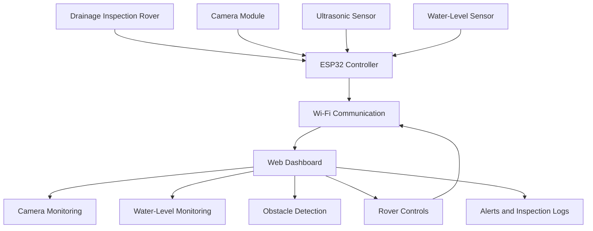

🌊 DRAIN PULSE
Smart Drainage Monitoring Rover & Flood Intelligence System

  <strong>Smart Flood Monitoring and Emergency Response Technology</strong>

  <a href="https://drain-pulse-monitering-agik.vercel.app/">🌐 Live Demo</a> •
  <a href="https://github.com/siddarthramasamy17-ui/DRAIN-PULSE-MONITERING-">📂 GitHub Repository</a>

🚀 Overview
DRAIN PULSE is an IoT-powered smart drainage inspection and monitoring system designed to identify potential blockages, monitor rising water levels, and improve flood preparedness.

The system combines an ESP32-powered robotic rover with a web dashboard to support remote inspection of stormwater drainage infrastructure.

Using camera monitoring, ultrasonic sensing, and telemetry analysis, DRAIN PULSE provides operators with insights into drainage conditions and helps identify potential flood risks before they escalate.

Developed for HACK2IMPACT 2026 – Heavy Rain & Flood Resilience, with a focus on addressing urban flooding challenges in Guayaquil, Ecuador.
🎯 Problem Statement
Urban flooding can be intensified by clogged stormwater drains, accumulated waste, and inadequate drainage monitoring.

Traditional inspection methods may require considerable manual effort, particularly when identifying blockages inside narrow or difficult-to-access drainage networks.

DRAIN PULSE proposes a compact robotic inspection platform that helps monitor drainage conditions, detect obstacles, and identify unusual water-level changes.
✨ Key Features
Feature	Description
📷 Camera Monitoring	Visual monitoring through an ESP32-CAM-compatible camera feed
🤖 Rover Control	Remote forward, reverse, and directional movement
💧 Water-Level Monitoring	Water-level telemetry and graphical visualization
📡 Obstacle Detection	Ultrasonic distance monitoring
🛑 Automatic Braking	Safety response when obstacles are too close
🔔 Critical Alerts	Audio alarms and notification support
📊 Live Telemetry	Dashboard visualization of available rover and sensor data
📝 Inspection Logs	Record and review identified drainage issues
⚙️ Connection Settings	Configure ESP32 network and communication settings

🏗️ System Architecture
The system is organized into three major layers.
1. Hardware Layer
- ESP32 controller
- ESP32-CAM or compatible camera module
- Ultrasonic distance sensor
- Water-level sensing module
- Robotic rover platform
- Motor driver and motors
2. Communication Layer
- Wi-Fi communication
- WebSocket-based hardware communication
- HTTP command interface, where supported
- Telemetry transmission between the rover and dashboard
3. Application Layer
- React-based monitoring dashboard
- Camera visualization
- Water-level graphs
- Rover movement controls
- Obstacle detection interface
- Alerts and inspection management
Data Flow

🛠️ Technology Stack
Frontend
- React 19
- TypeScript
- Vite
- Tailwind CSS 4
- Lucide React
- Motion
Hardware & IoT
- ESP32
- ESP32-CAM
- Ultrasonic sensor
- Water-level sensor
- Robotic rover platform
- Wi-Fi communication
Communication
- WebSocket
- HTTP API
Development & Deployment
- Google AI Studio
- GitHub
- Vercel
- Node.js
- npm
🖥️ Dashboard Modules
1. Camera Monitoring
Provides a visual interface for monitoring the drainage inspection rover through its camera stream.
2. Rover Navigation
Allows operators to control rover movement, adjust speed, and activate an emergency stop.
3. Water-Level Analytics
Displays water-level measurements, telemetry history, and configurable warning and critical thresholds.
4. Obstacle Detection
Visualizes ultrasonic distance measurements and supports automatic braking when an obstacle is too close.
5. Inspection Management
Enables operators to record and review detected drainage issues.
⚙️ Installation & Setup
Prerequisites
- Node.js
- npm
- Git
Step 1: Clone the repository
git clone https://github.com/siddarthramasamy17-ui/DRAIN-PULSE-MONITERING-.git
Step 2: Navigate to the project directory
cd DRAIN-PULSE-MONITERING-
Step 3: Install dependencies
npm install
Step 4: Start the development server
npm run dev
Open the local URL printed in the terminal (Vite commonly uses http://localhost:5173).
Step 5: Create a production build
npm run build
To preview the production build:
npm run preview
📡 Hardware Connectivity
DRAIN PULSE can be explored in simulation mode and, when compatible firmware and hardware are configured, connected to a physical ESP32 rover.
Simulation Mode
- Generates simulated rover telemetry.
- Allows dashboard features to be explored without physical hardware.
- Simulates sensor readings such as water level and obstacle distance.
Hardware Mode
- Connects to a configured ESP32 device.
- Uses the communication endpoints implemented by the ESP32 firmware.
- Sends supported rover movement and control commands.
- Receives sensor telemetry from the hardware.
Important: Hardware operation depends on compatible ESP32 firmware and matching network, endpoint, and message configurations. Confirm the values in the application and firmware before connecting. Do not assume the example network settings below apply to every setup.
Parameter	Example value
ESP32 IP address	192.168.4.1
WebSocket port	81
HTTP port	80
WebSocket path	/ws
Camera stream path	/stream

These are example configuration values, not guaranteed defaults.
🌍 Applications
DRAIN PULSE is designed to support:
- Stormwater drainage inspection
- Early identification of potential drainage blockages
- Water-level monitoring
- Urban flood-risk awareness
- Remote drainage infrastructure monitoring
The project explores how affordable embedded systems and IoT technology can contribute to smarter and more resilient urban infrastructure.
🔮 Future Improvements
- AI-powered garbage and blockage identification
- GPS-based rover location tracking
- GIS integration for drainage network visualization
- Flood-risk prediction using historical sensor data
- Emergency route intelligence for avoiding flooded roads
- Centralized monitoring of multiple drainage inspection rovers
- Municipal monitoring and reporting integration
👥 Project Team
Developed by students from Sri Sai Ram Engineering College.

Event: HACK2IMPACT 2026
Challenge: Heavy Rain & Flood Resilience
Focus Location: Guayaquil, Ecuador
📜 License
This project is developed for educational, research, and innovation purposes. Add a LICENSE file to the repository if you wish to publish it under a specific open-source license.

  <strong>🌊 DRAIN PULSE — Smarter Drains, Safer Cities.</strong>
</p
